## Найденные баги
| ID         | Приоритет | Краткое описание                                                     |
| ---------- | --------- | -------------------------------------------------------------------- |
| **BUG-01** | **P0**    | Объявление «На проверке» доступно на публичной странице              |
| **BUG-02** | **P1**    | Публичная карточка отображает некорректную цену                      |
| **BUG-03** | **P1**    | Публичная карточка некорректно отображает характеристики товара      |
| **BUG-04** | **P1**    | Состояние товара на публичной карточке не соответствует сохранённому |
| **BUG-05** | **P1**    | Количество товара не соответствует сохранённому                      |
| **BUG-06** | **P1**    | Статус доставки не соответствует настройкам продавца                 |
| **BUG-07** | **P2**    | Перепутаны значения высоты и глубины                                 |
| **BUG-08** | **P2**    | Публичная карточка отображает некорректный адрес                     |
| **BUG-09** | **P3**    | Не отображается количество просмотров на графике статистики          |
| **BUG-10** | **P3**    | Не отображается изображение в блоке дополнительных услуг             |
| **BUG-11** | **P3**    | Некорректное отображение текстовых элементов                         |

## BUG-01. Объявление «На проверке» доступно на публичной странице

**Приоритет:** P0

**Описание:**
Статус одного и того же объявления отображается по-разному в карточке продавца и на публичной карточке товара.

**Шаги воспроизведения:**
1. Открыть объявление в интерфейсе продавца.
2. Убедиться, что объявление имеет статус «На проверке».
3. Открыть публичную карточку этого объявления.

**Фактический результат:**
В карточке продавца объявление отображается как активное, а на публичной карточке товара указано, что оно находится на проверке. При этом публичная карточка доступна по прямой ссылке покупателю.
Дополнительно количество просмотров отображается по-разному: в карточке продавца — **0 просмотров**, на карточке товара — **8 просмотров**.

**Ожидаемый результат:**
Статус объявления и связанные с ним данные отображаются согласованно во всех интерфейсах. Объявление, находящееся на проверке, не должно быть доступно покупателям на публичной странице.

**Обоснование приоритета:**
Критичный дефект: объявление, находящееся на проверке, доступно покупателям, а его статус и данные отображаются несогласованно. Нарушение модерации и публикации контента.

**Вложение:**
1. Карточка продавца
   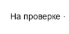
2. Карточка товара
   
---

## BUG-02. Публичная карточка отображает некорректную цену

**Приоритет:** P1

**Описание:**
Цена на публичной карточке товара не соответствует цене, указанной в форме редактирования и карточке продавца.

**Шаги воспроизведения:**
1. Открыть форму редактирования объявления.
2. Проверить значение поля «Цена».
3. Открыть карточку продавца.
4. Открыть публичную карточку товара.
5. Сравнить отображаемую цену.

**Фактический результат:**
В форме редактирования и карточке продавца указана цена **25 000 ₽**, на публичной карточке товара отображается **52 000 ₽**.

**Ожидаемый результат:**
На публичной карточке товара отображается цена, сохранённая в объявлении — **25 000 ₽**.

**Окружение:** тестовый стенд Avito, web

**Обоснование приоритета:**
Критичный дефект: некорректная цена напрямую вводит покупателя в заблуждение и может привести к претензиям со стороны покупателя и рискам финансового ущерба, так как цена - ключевой коммерческий параметр.

**Вложение:**
1. Карточка редактирования объявления
   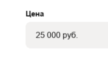

2. Карточка продавца
   

3. Карточка товара
   
---

## BUG-03. Публичная карточка некорректно отображает характеристики товара

**Приоритет:** P1

**Описание:**
Часть характеристик товара на публичной карточке не соответствует данным, указанным в форме редактирования. Значения также противоречат заголовку и другим характеристикам карточки.

**Шаги воспроизведения:**
1. Открыть форму редактирования объявления.
2. Проверить значения характеристик товара.
3. Открыть публичную карточку товара.
4. Сравнить характеристики с данными формы редактирования.

**Фактический результат:**
На публичной карточке отображаются некорректные значения:
* Форма — «Прямой» вместо «Угловой»;
* Модульный — «Нет» вместо «Да»;
* Спальное место — «Нет» вместо «Есть»;
* Раскладной механизм — «Нет» вместо «Есть».

Существующий размер спального места 140*200 противоречит тому, что выше указали, что спального места нет.

**Ожидаемый результат:**
Характеристики на публичной карточке соответствуют данным, сохранённым в форме редактирования, и не противоречат другим элементам карточки.

**Окружение:** тестовый стенд Avito, web

**Обоснование приоритета:**
Высокий приоритет: некорректные характеристики существенно искажают информацию о товаре и могут повлиять на решение о покупке.

**Вложения:**
1. Характеристики в форме редактирования
   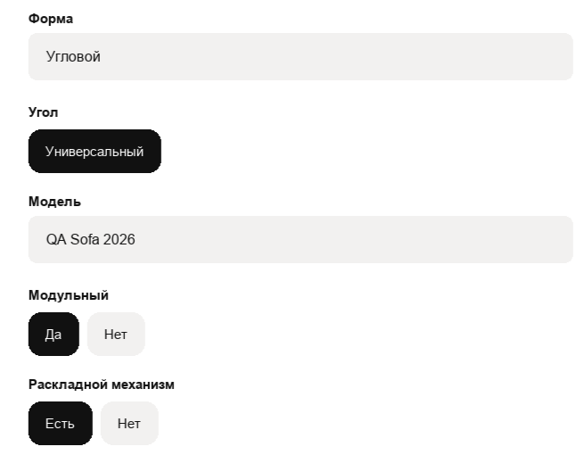
2. Характеристики на публичной карточке
   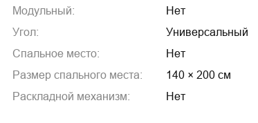
---

## BUG-04. Состояние товара на публичной карточке не соответствует сохранённому

**Приоритет:** P1

**Описание:**
Значения состояния товара на публичной карточке не соответствуют данным, указанным в форме редактирования объявления.

**Шаги воспроизведения:**
1. Открыть форму редактирования объявления.
2. Проверить значения состояния товара.
3. Открыть публичную карточку товара.
4. Сравнить значения состояния.

**Фактический результат:**
В разделе «О диване» на публичной карточке отображается:
* Состояние обивки — «Требует замены» вместо «Всё в порядке»;
* Раскладной механизм — «Требуется ремонт» вместо «Всё в порядке»;
* Каркас — «Требуется ремонт» вместо «Всё в порядке».

**Ожидаемый результат:**
На публичной карточке отображаются значения состояния товара, соответствующие данным, сохранённым в форме редактирования.

**Окружение:** тестовый стенд Avito, web

**Обоснование приоритета:**
Высокий приоритет: некорректные характеристики существенно искажают информацию о товаре и могут повлиять на решение о покупке.

**Вложения:**
1. Характеристики в форме редактирования
   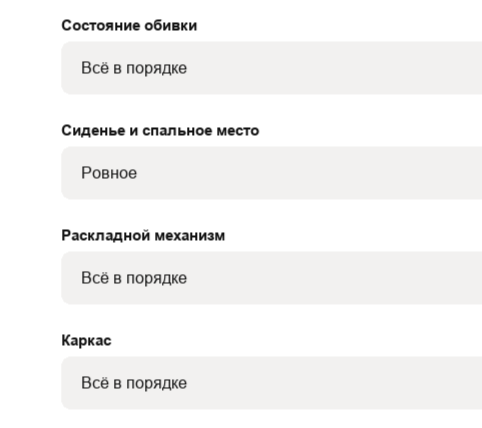
2. Характеристики на публичной карточке
   
---

## BUG-05 Количество товара не соответствует сохранённому

**Приоритет:** P1

**Описание:** 
Количество товара на публичной карточке не соответствует значению, сохранённому в форме редактирования объявления.

**Шаги воспроизведения:**
1. Открыть форму редактирования объявления.
2. Проверить значение поля «Количество».
3. Открыть публичную карточку товара.
4. Сравнить указанное количество товара.

**Фактический результат:**
В форме редактирования указано количество 1 шт., на публичной карточке товара отображается 3 шт.

**Ожидаемый результат:**
На публичной карточке отображается фактическое количество товара, сохранённое в объявлении — 1 шт.

**Окружение:** тестовый стенд Avito, web

**Обоснование приоритета:**
Высокий приоритет: некорректное количество товара может привести к продаже большего количества товара, чем имеется в наличии.

**Вложения:**
1. Карточка товара
   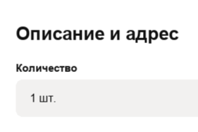
2. Карточка редактирования объявления
   

## BUG-06. Статус доставки не соответствует настройкам продавца

**Приоритет:** P1

**Описание:**
На публичной карточке статус доставки не соответствует настройкам, установленным продавцом.

**Шаги воспроизведения:**
1. Открыть форму редактирования объявления.
2. Проверить настройку «Авито Доставка».
3. Открыть карточку продавца и публичную карточку товара.
5. Сравнить статус доставки.

**Фактический результат:**
В форме редактирования и карточке продавца доставка включена, однако на публичной карточке отображается сообщение «Доставка недоступна» и указано, что продавец отключил доставку.

**Ожидаемый результат:**
Статус доставки и связанные с ним элементы публичной карточки соответствуют настройкам продавца. 

**Окружение:** тестовый стенд Avito, web

**Обоснование приоритета:**
Высокий приоритет: пользователь не получает доступную услугу, нарушен ключевой сценарий покупки

**Вложения:**
1. Карточка редактирования объявления
   

2. Карточка продавца
   

3. Карточка товара
   

## BUG-07. Перепутаны значения высоты и глубины

**Приоритет:** P2

**Описание:**
На публичной карточке товара значения характеристик «Высота» и «Глубина» отображаются в обратном порядке относительно сохранённых данных.

**Шаги воспроизведения:**
1. Открыть форму редактирования объявления.
2. Проверить значения габаритов товара.
3. Открыть публичную карточку товара.
4. Сравнить значения характеристик «Высота» и «Глубина».

**Фактический результат:**
В форме редактирования указано:
* Ширина — **220 см**
* Глубина — **95 см**
* Высота — **85 см**

На публичной карточке:
* Ширина — **220 см**
* Высота — **95 см**
* Глубина — **85 см**
Значения высоты и глубины поменяны местами.

**Ожидаемый результат:**
На публичной карточке значения габаритов отображаются в соответствии с данными, сохранёнными в форме редактирования: **Высота — 85 см, Глубина — 95 см**.

**Окружение:** тестовый стенд Avito, web

**Обоснование приоритета:**
Средний приоритет: ошибка искажает характеристики товара и может ввести покупателя в заблуждение относительно его размеров.

**Вложение:**
1. Габариты на карточке редактирования объявления 
   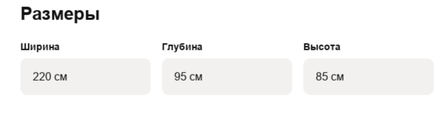
2. Габариты на карточке товара
   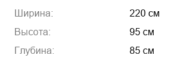
---

## BUG-08. Адрес на публичной карточке отличается от сохранённого

**Приоритет:** P2

**Описание:**
Адрес, отображаемый на публичной карточке товара, не соответствует адресу, указанному в форме редактирования и карточке продавца.

**Шаги воспроизведения:**
1. Открыть форму редактирования объявления.
2. Проверить указанный адрес.
3. Открыть карточку продавца и публичную карточку товара.
4. Сравнить отображаемый адрес.

**Фактический результат:**
В форме редактирования и карточке продавца указан адрес: **Москва, пл. Революции, 3**.
На публичной карточке товара отображается: **Москва, пл. Революции, 5**.

**Ожидаемый результат:**
На публичной карточке товара отображается адрес, соответствующий сохранённым данным: **Москва, пл. Революции, 3**.

**Окружение:** тестовый стенд Avito, web

**Обоснование приоритета:**
Средний приоритет: некорректный адрес может ввести покупателя в заблуждение относительно местоположения товара.

**Вложение:**
1. Адрес на карточке товара
    
2. Первоначальный адрес на карточке редактирования объявления 
   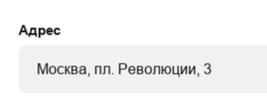
3. Адрес на карточке продавца
   
---

## BUG-09 Не отображается количество просмотров на графике статистики

**Приоритет:** P3

**Описание:** 
В блоке «Статистика за неделю» на карточке товара значение просмотров не отображается на графике. За период с 10 по 16 августа зафиксировано 8 просмотров, однако соответствующее значение на графике отсутствует.

**Шаги воспроизведения:**
1. Открыть страницу карточки товара.
2. Найти блок «Статистика за неделю». 

**Фактический результат:**
На графике статистики за период с 10 по 16 августа не отображается значение в 8 просмотров

**Ожидаемый результат:**
На графике отображается фактическое количество просмотров

**Окружение:** тестовый стенд Avito, web

**Обоснование приоритета:**
Дефект влияет на визуальное представление статистики: фактическое количество просмотров не отображается на графике, однако не приводит к потере или изменению данных.

**Вложения:**

1. График статистики
   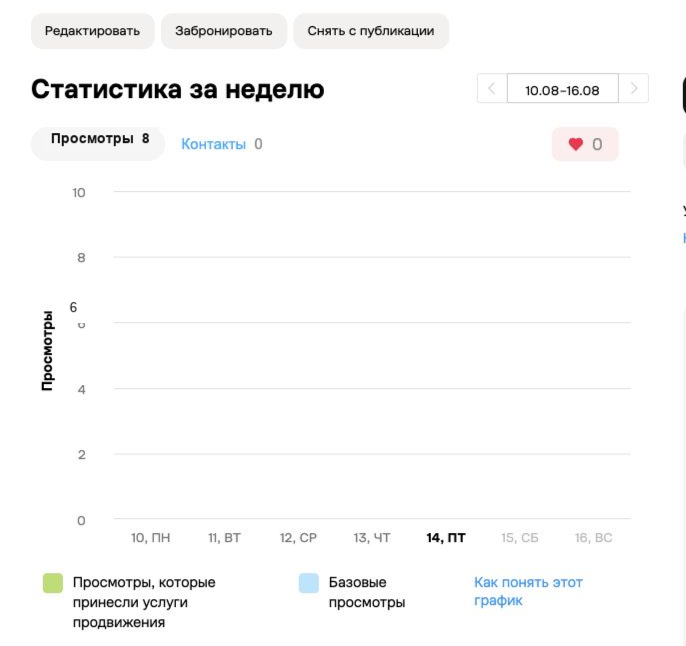
---

## BUG-10 Не отображается изображение в карточках продавца и в блоке дополнительных услуг товара

**Приоритет:** P3

**Описание:** 
На карточке продавца и карточке товара в блоке дополнительных услуг не отображается изображение одной из услуг. Вместо изображения отображается стандартный плейсхолдер отсутствующего изображения.

**Шаги воспроизведения:**
1. Открыть страницу карточки продавца.
2. Найти блок дополнительных услуг "Привлекайте покупателей", в котором во втором пункте "Скидки в test_sale_ops" отсутствует изображение. 
3. Открыть страницу карточки товара.
4. Найти блок дополнительных услуг "Найти своё на ресейле", в котором отсутствует изображение.

**Фактический результат:**
Изображение дополнительной услуги не загружается: вместо него отображается стандартный плейсхолдер битого/отсутствующего изображения. 

**Ожидаемый результат:**
В карточке продавца и карточке товара в блоке дополнительной услуги корректно отображается предусмотренное изображение.и. 

**Окружение:** тестовый стенд Avito, web

**Обоснование приоритета:**
Картинка декоративная и отсутствие изображения не мешает понять назначение услуги.

**Вложения:**
1. Карточка продавца  
   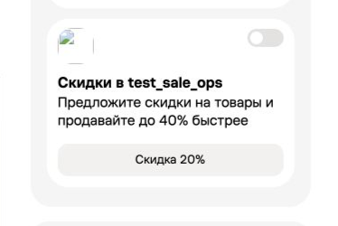
2. Карточка товара
   
---

## BUG-11 Некорректное отображение текстовых элементов.

**Приоритет:** P3

**Описание:**
Некорректное отображение текстовых элементов: дублирование надписи на странице редактирования объявления и смещение текста относительно эконки на странице карточки товаров.

**Шаги воспроизведения:**
1. Открыть страницу редактирования объявления.
2. Найти блок с дублирующимся текстом. 
3. Открыть страницу карточки продавца.
4. Найти блок с иконкой, в которой текст расположен не по центру. 

**Фактический результат:**
Текстовые элементы отображаются некорректно: одна надпись дублируется, а другая подпись расположена со смещением относительно соответствующей иконки. 

**Ожидаемый результат:**
Каждый текстовый элемент отображается один раз и симметрично относительно соответствующей иконки. 

**Окружение:** тестовый стенд Avito, web

**Обоснование приоритета:**
Дефект не блокирует работу с объявлением, однако ухудшает визуальное восприятие интерфейса.

**Вложения:**
1. Дублирование текста  
   
2. Смещение текста относительно иконки  
   